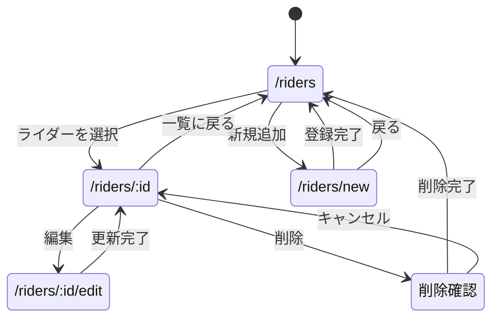
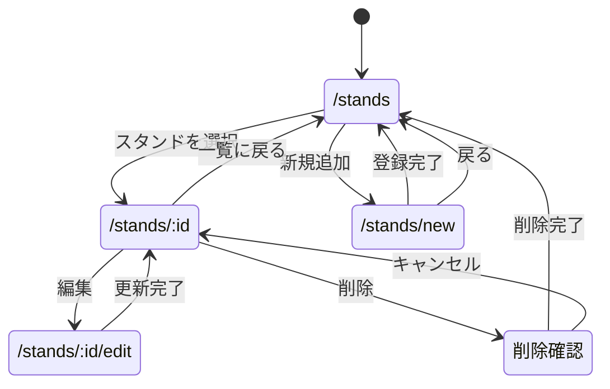
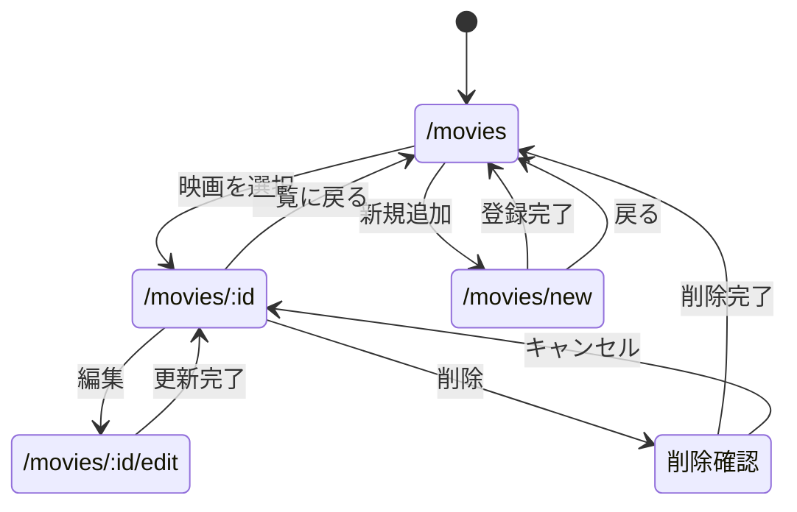

# Webプログラミング  レポートシステム設計

## 1．仮面ライダーシステム

### システム概要
仮面ライダーの情報を管理するWebアプリケーション．
仮面ライダーの名前，登場作品，変身者，モチーフなどを登録し，一覧表示や詳細表示を行う．

### ページ遷移図

### スキーマ

| 項目名 | データ型 | 内容 |
|---|---|---|
| id | Number | ライダーID |
| name | String | ライダー名 |
| series | String | 登場作品 |
| user | String | 変身者 |
| motif | String | モチーフ |
| description | String | ライダーの説明 |

### 実装予定の機能
- 仮面ライダーの一覧表示
- 仮面ライダーの詳細表示
- 新しい仮面ライダーの追加
- 登録済みライダーの情報変更
- 登録済みライダーの削除

---

## 2．ジョジョスタンドシステム

### システム概要
ジョジョの奇妙な冒険に登場するスタンドの情報を管理するWebアプリケーション．
スタンド名，本体名，登場部，能力などを登録し，一覧表示や詳細表示を行う．

### ページ遷移図

### スキーマ

| 項目名 | データ型 | 内容 |
|---|---|---|
| id | Number | スタンドID |
| name | String | スタンド名 |
| user | String | スタンド本体名 |
| part | Number | 登場する部 |
| ability | String | スタンド能力 |
| range | String | 射程距離 |

### 実装予定の機能
- スタンドの一覧表示
- スタンドの詳細表示
- 新しいスタンドの追加
- 登録済みスタンドの情報変更
- 登録済みスタンドの削除

---
## 3．映画システム

### システム概要
映画の情報を管理するWebアプリケーション．
映画タイトル，ジャンル，公開年，あらすじなどを登録し，一覧表示や詳細表示を行う．

### ページ遷移図

### スキーマ

| 項目名 | データ型 | 内容 |
|---|---|---|
| id | Number | 映画ID |
| title | String | 映画タイトル |
| genre | String | ジャンル |
| year | Number | 公開年 |
| description | String | あらすじ |

### 実装予定の機能
- 映画の一覧表示
- 映画の詳細表示
- 新しい映画の追加
- 登録済み映画の情報変更
- 登録済み映画の削除

---